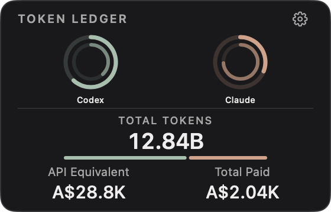
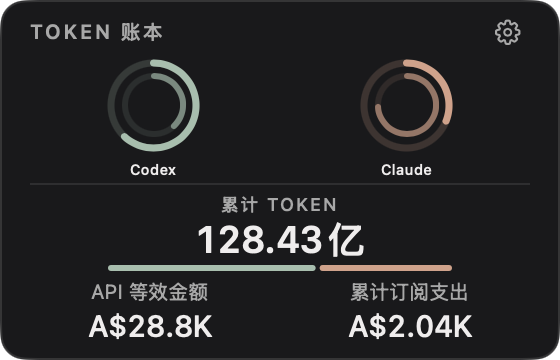

# Token Ledger

Token Ledger is a small, native macOS floating panel for AI usage limits, lifetime tokens, and subscription payments.

| English | 简体中文 |
| --- | --- |
|  |  |

The screenshots show the running app with sample usage and payments.

## What it shows

- Five-hour and weekly quota rings.
- Lifetime tokens and a distribution bar based on recorded local usage.
- Estimated API-equivalent cost and cumulative subscription payments.
- AUD by default, with USD, CNY, EUR, and GBP available in Settings.

The Chinese interface uses 万, 亿 and 万亿 for token counts. Monetary amounts use K, M, B and T in both languages.

The panel supports English and Simplified Chinese, multiple displays, and full-screen Spaces where macOS permits.
Use **Control–Option–Command–L** to show or hide it. The menu bar item opens Settings and restores mouse input
when click-through is enabled.

## Supported providers

| Provider | Quotas | Recorded usage |
| --- | --- | --- |
| Codex | Signed-in Codex CLI | Local active and archived Codex rollouts |
| Claude | Signed-in Claude Code CLI | Local first-party Claude Code transcripts |

Sign in to each provider through its CLI. Settings controls panel visibility and collection independently.

## Install and build

Requires macOS 14 or later and Swift 6 with the macOS SDK. Install the app bundle by moving **Token Ledger.app**
to Applications and opening it. The build below creates an ad-hoc signed local bundle.

```sh
./Scripts/package.sh release
open "dist/Token Ledger.app"
./Scripts/test.sh
```

Build requirements and packaging are independent of provider setup. Enable **Launch at Login** in Settings if desired.

## Known limitations

- Local history covers readable logs on this Mac. A new sign-in changes the displayed quotas, while previously
  recorded usage remains part of the machine’s lifetime total.
- The token total uses the signed-in Codex account’s Profile count from `account/usage/read` and locally recorded
  Claude tokens. Token Ledger uses its last successful Profile count while app-server can confirm the same user
  and workspace. Local Codex tokens provide the fallback. The distribution bar and API Equivalent use local logs.
- Hidden providers remain in aggregate totals. Disabling collection keeps recorded usage and stops new collection.
  Deleting recorded usage clears the local ledger and sets a cutoff so replayed older logs stay excluded.
- Codex collection uses the modern stream where it covers a rollout and retains legacy-only usage. Claude
  collection consolidates streamed observations of the same request. Uncertain legacy or forked history can appear
  as a lower bound.
- **API Equivalent** estimates replacement value using the highest published Standard base-context schedule for
  each provider’s two most-used models. Other priced models use a token-weighted blend of those rates. Unpriced
  Codex IDs use GPT-6 Astra as a pricing proxy. Input, cached input, cache creation, and output use their own rates.
  Older totals without a breakdown use the provider’s observed average value per token when available.
- Pricing updates daily from model-prices, with models.dev as a fallback. Compact cached rates remain available
  offline. The ledger stores usage summaries and collection checkpoints. On upgrade it backs up the previous
  ledger and reconciles it with available logs. Recorded usage remains available after log rotation or removal.
- Reading unseen compressed Codex archives requires a local `zstd` executable. Quota access can be unavailable when
  the vendor CLI cannot show its usage panel or returns an error. Cached exchange rates remain available offline.
- **Total Paid** is based on manual records in their original currencies. It can include marked estimates.

## License

MIT. [License and copyright](LICENSE) · [Source attribution](THIRD_PARTY_NOTICES.md)
